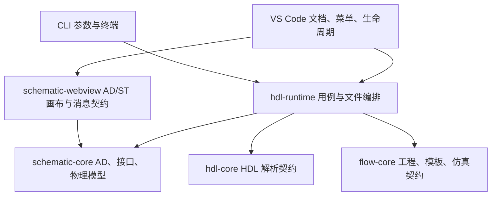

# 架构与模型维护索引

## 入口和依赖方向

VS Code 扩展提供完整产品交互，CLI 提供脚本和单文件快捷操作；两者调用同一套 TypeScript 业务实现。



| 位置 | 维护内容 |
| --- | --- |
| `packages/schematic-core/src/archDesign` | AD 解析、编辑、解析后的图和 RTL 生成 |
| `packages/schematic-core/src/physical*.ts` | 板卡模型、绑定、端口和 XDC 纯算法 |
| `packages/hdl-runtime/src/archDesign` | HDL 定义身份、脚本编辑批次、RTL/XDC 构建计划 |
| `packages/hdl-runtime/src/artifacts` | 输入快照、输出冲突、生成归属、文件发布 |
| `packages/hdl-runtime/src/physical` | 板卡文件、用户库、资源和 RTL 端口解析 |
| `packages/hdl-runtime/src/interfaces` | 工程逻辑协议文件加载与诊断 |
| `packages/hdl-runtime/src/simulationTask*` | ST 模型、编辑、预设、TB 和工作区来源解析 |
| `packages/hdl-runtime/src/hdl` | 例化、快捷 TB 的纯文本生成 |
| `packages/schematic-webview/src` | AD/ST 共用画布；`shared` 提供消息、布局和 UI 辅助 |
| `packages/cli/src/commands` | 参数适配、终端输出和退出码 |
| `veriflow-vscode/src` | 原生编辑器事务、菜单、索引生命周期、Webview 宿主 |

可自动化的能力先写共享 TS API，再接 CLI 和扩展。共享包不能导入扩展源码或 `vscode`。扩展旧模块中的转导出保留调用兼容，业务实现只在共享包维护。画布测试归 `schematic-webview`，独立波形宿主测试归 `waveform-desktop`。

## JSON 模型在哪里

| 模型 | 唯一维护源 | 消费方式 |
| --- | --- | --- |
| AD 文档 v2 | 用户工程的 `.ad`；解析器在 `schematic-core/src/archDesign` | 画布与 `arch`；`physical` 是该设计引脚配置的持久化来源 |
| ST 文档 v1 | 用户工程的 `.st`；模型在 `hdl-runtime/src/simulationTask` | 画布与 `task`；引用 HDL/AD，保存预设、连线与运行设置 |
| AXI4、AXIS、APB、AHB-Lite 逻辑协议 | `packages/schematic-core/src/interfaces/builtins/*.json` | 随共享包编译发布；工程可通过 `project.json` 的 `interfaceProtocolFiles` 扩充 |
| 通用物理接口 | `data/physical-models/interfaces` | 同一复制函数交付到运行时 npm 包和扩展资源目录 |
| 板卡与板卡专用接口 | `data/physical-models/boards/<id>` | 用户导入或文档相对引用；相对接口导入后保存快照 |
| 用户板卡与自定义接口 | `~/.veriflow_config.json` | 两入口共用；保存保留其他设置，检测配置变化 |
| RTL 引脚绑定 | 用户工程的 `*.pins.json` | 复用 `PhysicalConfiguration`；扩展显式加载/保存，CLI `pins --config` |
| 物理模型 Schema | `packages/schematic-core/schemas/physical-interface-model.schema.json` | 校验脚本和扩展构建消费副本 |
| ST Schema | `packages/hdl-runtime/schemas/simulation-task.schema.json` | npm 导出和扩展 JSON 编辑器消费副本 |
| 子卡和装配示例 | `data/physical-models/examples` | 模型与校验夹具；尚未提供装配操作面板 |

`data/physical-models` 只承担硬件资源。AD/ST 是工程文档，逻辑协议定义信号关系；它们的所有权按领域划分。

构建副本不手工维护：`packages/hdl-runtime/resources/physical-models/interfaces`、`veriflow-vscode/resources/physical-models/interfaces` 和 `veriflow-vscode/schemas`。运行时按安装位置定位接口资源，不依赖启动目录。保留 `user:<id>`、`library:interfaces/<file>.json`、相对路径与用户快照语义。当前约束生成支持 AMD XDC。

## 构建与检查

```bash
npm ci
npm run build                         # 模型校验、共享 TS、Web UI、扩展
npm run build:cli                     # CLI 与独立波形宿主
npm run test:maintenance              # 构建、发布辅助和资源复制回归
npm run test:shared
npm run test:cli
npm test --workspace @veriflow/schematic-webview
npm run test:browser --workspace @veriflow/schematic-webview
```

Linux 的 Electron 测试需要显示服务，可用 `xvfb-run -a`。`build:parser` 单独维护 SEA 实验；普通产品构建不运行 SEA 探针。常规重构不需要版本更新或发布打包。

## CLI 命令与脚本构筑

正式名称统一为 **`veriflow arch` / `veriflow task`**；`ad` 作为 `arch` 的兼容别名，文档和新脚本使用全称。

```bash
veriflow arch new top -o top.ad
veriflow arch apply top.ad --ops arch-edits.json --in-place
veriflow arch build top.ad -o generated/top.v --xdc-output generated/top.xdc

veriflow task new -o sim.st
veriflow task apply sim.st --ops task-edits.json --in-place
veriflow task tb sim.st -o generated/sim_tb.v
veriflow task validate sim.st
veriflow task run sim.st

veriflow board import data/physical-models/boards/atk-au15p/board.json --id demo
veriflow board list --json
veriflow board validate user:demo
veriflow board export user:demo -o demo-board.json
veriflow pins validate top.ad
veriflow pins export top.v --config top.pins.json -o generated/top.xdc

veriflow hdl format top.v --check
veriflow hdl format top.v --in-place
veriflow hdl instantiate top.v --module top
veriflow hdl template --list
veriflow hdl template --template clock
veriflow hdl tb top.v -o top_tb.v
veriflow hdl run top_tb.v --wave-output results/top.vcd
```

`arch build` 无 `physical` 时只生成 RTL，有 `physical` 时校验板卡并生成 RTL/XDC。`--rtl-only` 显式跳过物理构建。`arch export` 保留只导出 RTL 的语义。RTL 路径优先级为 CLI 参数、`export.output`、同名 RTL；XDC 为 CLI 参数、`export.xdcOutput`、实际 RTL 的同名 XDC。

### AD 操作文件

`arch-edits.json`：

```json
{
  "format": "veriflow-arch-edits",
  "schemaVersion": 1,
  "operations": [
    { "type": "addPort", "port": { "name": "led", "direction": "output" } },
    { "type": "setDefault", "endpoint": "led.value", "expression": "1'b0" }
  ]
}
```

图编辑复用 `ArchDesignEdit`，包括端口、连线、参数、逻辑、接口和 `setPhysical`。脚本加入 HDL 实例使用 `{ "type": "addSourceInstance", "id": "dut", "source": { "kind": "hdl", "path": "rtl/dut.v", "module": "dut" } }`，由运行时解析准确的定义身份。

### ST 操作文件

假定 `dut.v` 定义 `module dut(input clk); ... endmodule`，`task-edits.json`：

```json
{
  "format": "veriflow-task-edits",
  "schemaVersion": 1,
  "operations": [
    { "type": "addSourceInstance", "id": "dut", "source": { "kind": "hdl", "path": "dut.v", "module": "dut" } },
    { "type": "addPreset", "id": "clock", "preset": { "kind": "clock", "frequencyMHz": 100, "initial": 0 } },
    { "type": "connect", "source": { "kind": "instance", "instance": "clock", "port": "clk" }, "target": { "kind": "instance", "instance": "dut", "port": "clk" } },
    { "type": "updateTaskSettings", "settings": { "duration": 100 } }
  ]
}
```

ST 另支持 AD 来源 `{ "kind": "ad", "path": "top.ad" }`、reset/stimulus/protocol 预设、`updatePreset` 和共享图操作。源文件路径相对目标 AD/ST，操作文件路径只由 `--ops` 定位。整批在内存编辑，完成后校验语义；失败带操作序号且不写回源文件。

### 输出保护

编辑必须显式选 `--in-place` 或 `--output`。另存编辑文档暂限同目录，避免改变相对引用。新文件拒绝覆盖，已有生成产物只允许同一来源和类型替换。构建先检查全部输出及输入快照；已知冲突不发布任何产物。发布中途失败会报告已发布清单，跨文件发布不承诺事务回滚。

新增的构建、编辑、板卡、引脚和 HDL 命令提供 `--dry-run` / `--json`；JSON 信封为 `veriflow-result` v1。文本生成默认 stdout 输出正文，指定 `-o` 时写文件。退出码：0 成功、1 校验或执行失败、2 参数错误。仿真完成仅表示后端正常执行。

引脚面板操作见 [引脚绑定与 XDC](physical-pin-bindings.md)，硬件字段见 [物理模型](physical-interface-model.md)。
