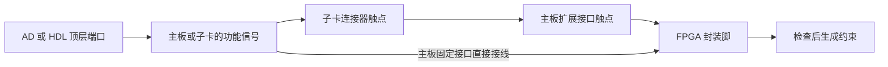

# 物理接口、板卡与子卡模型 V1

状态：2026-10-14 数据契约草案，供接口库录入与评审。JSON Schema 和示例已提供；插件尚未读取这些文件，也尚未实现装配解析、冲突检查或约束导出。

对应 [开发计划](develop_plan.md) 1.6.x 的 AD 约束编辑与导出。此次交付接口建模规范；后续由用户依据本规范定义常用接口，再实现 AD 集成。

## 1. 两类接口，四种文档

接口定义只有 `fixed` 与 `expansion` 两类。子卡是一块具有连接器和功能接口的硬件，使用这两类定义组合描述。

| 文档 | `format` | 记录内容 |
| --- | --- | --- |
| 接口定义 | `veriflow-physical-interface` | 固定接口信号，或扩展接口触点；分组与差分对 |
| 主板定义 | `veriflow-board` | 器件、封装脚、供电、Bank、接口实例及实际接线 |
| 子卡定义 | `veriflow-daughtercard` | 对接连接器、功能接口，以及功能信号到连接器触点的接线 |
| 工程装配 | `veriflow-board-assembly` | 主板、已安装子卡、硬件设置、勾选内容与 AD/HDL 端口绑定 |



方向、功能与分组来自接口定义；接线与电气条件来自具体硬件；使用哪些功能与端口名称来自工程装配。一个接口定义可以实例化多次，一个子卡定义可以安装到不同主板。

推荐该组合方式。只保存 XDC 文本片段会丢失可检查的接线关系；建立通用原理图网络模型则会扩大到元件与电路设计。本模型只记录约束生成实际需要的边界信号和接线。

## 2. 通用字段与引用

所有文档必须包含 `format`、`schemaVersion: 1`、`id`、`revision`、`name`；可填写 `description` 与编辑器用的 `$schema`。示例中各类空数组也显式保留。

| 字段 | 规定 |
| --- | --- |
| `id` | 稳定标识，匹配 `[A-Za-z_][A-Za-z0-9_.-]*`，区分大小写 |
| `revision` | 非空字符串；接口契约版本或板卡硬件版本，例如 `1`、`rev-a` |
| `name` | 显示名称，可使用中文 |
| 成员 ID | 固定接口信号遵守 `id` 规则；连接器触点、封装脚、Bank 允许数字开头，例如 `1`、`D6`、`13` |
| 文件引用 | `{ "path": "hdmi.fixed.json", "id": "fixed.hdmi.source", "revision": "1" }` |

引用路径相对包含该引用的文档解析。必须同时校验被引用文档的 `id` 与 `revision`，禁止仅按名称猜测、静默接受别的硬件版本，或自动切换到最新版本。同一 `(id, revision)` 的多份定义必须具有相同内容；内容不同时报错。

`schemaVersion` 表示本数据格式的版本；`revision` 表示定义自身的版本，两者独立。改变成员 ID、接线、编号或电气条件须创建新的 `revision`；显示名称修正可保留版本。所有未知字段在 V1 Schema 中拒绝。

## 3. 固定接口 `fixed`

固定接口表示功能信号集合，例如 UART、I2C、SPI、HDMI 输出、HDMI 输入。这里的“固定”表示某个硬件实例的用途和接线已确定，具体封装脚随后由主板或子卡记录。

| 字段 | 规定 |
| --- | --- |
| `kind` | 固定为 `fixed` |
| `function` | 可选的功能分类字符串，例如 `uart`、`hdmi-source`；不进行自动协议推断 |
| `signals` | 非空数组，每项代表一根标量信号线 |
| `groups` | 可勾选分组；成员均引用 `signals[].id` |
| `differentialPairs` | `{ id, positive, negative }`，引用两根独立信号 |

每个信号包含 `id`、`direction`；可填写 `name`、`description`、`drive`。**`direction` 始终以最终 FPGA 顶层端口为视角**：`input` 进入 FPGA，`output` 离开 FPGA，`inout` 双向。子卡接口沿用同一视角，安装时不翻转方向。

例如 UART 的 FPGA `tx` 是 `output`，`rx` 是 `input`；ADC 子卡数据通常是 `input`；HDMI 发送与接收使用不同接口定义。`drive` 描述 FPGA 的驱动方式，只用于 `output` 或 `inout`，`input` 不填写。I2C、DDC、CEC 等可定义为 `inout` 与 `drive: "open-drain"`，不套用现有逻辑接口模型的 `master-to-slave` 方向。

一个信号 ID 只表示一根线。并行总线先按 `data0`、`data1` 等成员展开，工程中再绑定 `data` 的实际位索引。差分信号分别声明 P/N 两根线，然后声明差分对；定义差分对不会生成缓冲器或改变 HDL。

### 分组与部分选用

每个分组包含 `id`、`name`、`members` 与 `selection`：

- `individual`：整组选中时启用所有成员，允许进一步选择部分成员。
- `together`：作为整体使用，勾选任意成员均启用全组。

接口实例本身是 UI 的父节点。组是其直接子节点，成员还可以属于多个组。组与差分对只引用同一份成员数据；不复制信号，不额外占用封装脚。

HDMI 输出示例的分组为：

| 组 ID | 成员 | 选择方式 |
| --- | --- | --- |
| `tmds` | `data0_p/n`、`data1_p/n`、`data2_p/n`、`clock_p/n` | 可部分选用；每个差分对成对选择 |
| `ddc` | `ddc_scl`、`ddc_sda` | 整体选择 |
| `hpd` | `hpd` | 独立选择 |
| `cec` | `cec` | 独立选择 |

父节点支持全选与半选显示。选择展开规则为：合并显式成员与所选组成员，反复补齐相关 `together` 分组及差分对，直到成员集合不再变化。重复成员去重。取消选择也必须遵守整体分组与差分对规则。

组合闭包只决定使用哪些信号；不自动增加协议依赖。例如选择 DDC 是否需要 HPD，应由实际用途决定，不由接口名称推断。

## 4. 扩展接口 `expansion`

扩展接口表示排针、FMC 等连接器的触点集合。

| 字段 | 规定 |
| --- | --- |
| `kind` | 固定为 `expansion` |
| `mechanical` | 机械规格标识，例如 `header-2x20-2.54mm`、`fmc-lpc` |
| `matingProfile` | 明确的对接脚位约定；相同值表示按规范触点编号可以直接对接 |
| `numbering` | 必填文本，说明观察面、Pin 1 位置、排列方式和子卡编号的对应视角 |
| `contacts` | 非空数组，每项记录一个真实触点的 `id` 与 `role` |
| `groups` | 可选用触点的分组，结构与固定接口相同 |
| `differentialPairs` | 连接器上的差分配对，引用 `contacts[].id` |

触点 `role` 为 `signal`、`power`、`ground` 或 `nc`。可填写 `label`、`description`、`capabilities`。能力标记建议使用 `gpio`、`clock-input`、`clock-output`、`transceiver-tx`、`transceiver-rx`；能力标记需由硬件资料确认，未记录时不能认为具备该能力。

触点 ID 表示物理编号，`label` 表示功能标签。FMC 应使用规范中的行列触点编号作为 ID，例如 `D6`，把 `LA00_P` 放在标签中。LA/HA/HB、时钟、GT、VADJ、供电与管理触点都分别记录。LPC/HPC 使用各自的完整脚位约定，不自动判定交叉兼容。

**40 PIN 只说明针数，不能确定电源、地、GPIO位置或电压。** 通用机械规格相同而接线不同的排针必须使用不同 `matingProfile`。同一对接规范可有两个接口定义，只要触点角色、编号、差分配对与能力一致。

本版按统一的对接触点 ID 进行一对一匹配。子卡的触点 ID 指向其实际接触的主板触点；背面观察造成的镜像必须在录入时换算，并写入 `numbering`。需要转接板、翻转线缆或改线时，应记录明确的硬件接线定义，不能通过选择“40 PIN”隐式互换触点。

供电、地和 NC 触点不能绑定为 AD 数据端口。实际主板未连接的信号触点，可在主板接线中标记为 `nc`；接口定义仍保留该位置。

## 5. 主板定义与物理接线

主板记录以下数据：

| 字段 | 内容 |
| --- | --- |
| `device` | `vendor`、完整 `part` 与 `package`，均必填 |
| `rails` | 电源轨及电压；电压类型为固定、可选择或未知 |
| `banks` | Bank ID；已知供电时通过 `supplyRail` 引用唯一电源轨 |
| `fpgaPins` | 封装脚 ID；可记录 Bank、能力、允许的 I/O 标准和预留策略 |
| `differentialPairs` | FPGA 封装的真实 P/N 配对 |
| `interfaces` | 固定接口和扩展接口实例，分别引用接口定义 |
| `selectors` | 跳线、开关、装配选项及其允许值 |
| `routes` | 接口成员到 FPGA 封装脚、电源轨、地、NC 或预留位置的接线 |

`routes` 的基本结构：

```json
{
  "interface": "J1",
  "member": "13",
  "target": { "kind": "fpga", "pin": "A9" },
  "when": [{ "selector": "JP1", "value": "header" }],
  "contactElectrical": { "voltageMv": 3300 },
  "fpgaElectrical": { "ioStandard": "LVCMOS33", "vccoMv": 3300 }
}
```

`when` 可省略，表示始终连接；填写时为非空条件数组，所有条件都满足才启用该接线。条件只能使用本硬件的选择器和值，没有脚本或表达式。一个成员可有多条条件接线，但同一设置下最多只能启用一条；成员没有启用接线表示当前硬件设置下不可用。

硬件选择器没有隐式默认值。求解所需值必须在工程装配中明确记录；缺失时标记未知，禁止猜测某条条件接线。软件填写跳线设置只记录事实，不能改变实际硬件；UI 应显示需要用户核对的跳线位置。

相同封装脚可以被多个接口或 GPIO 位置引用，表示真实共享资源。通过条件接线描述硬件复用器、跳线或装配选项。两个外设直接焊在同一网络上时，取消勾选不会断开电路；需保留接线事实，并检查是否存在其他驱动源或外设负载。已知的驱动冲突应阻止使用，资料不足时必须提示未验证。

封装脚的 `reservation` 为 `{ policy: "warn" | "forbid", reason }`。预留 GPIO 可以使用 `warn` 描述原用途；电源、配置、禁止使用的脚应标记 `forbid` 或不提供可选信号接线。

## 6. 子卡定义与安装映射

子卡用 `connectors` 记录用于对接主板的扩展接口实例，用 `interfaces` 记录提供的固定功能接口实例。两者使用同样的 `{ id, definition }` 引用结构；各自的实例 ID 在整个子卡中也不能重复。

子卡 `routes` 把功能信号接到自身连接器触点：

```json
{
  "interface": "HDMI0",
  "member": "data0_p",
  "target": { "connector": "P1", "contact": "5" },
  "contactElectrical": { "voltageMv": 3300, "requiredCapabilities": ["gpio"] }
}
```

子卡也可有 `selectors` 和条件接线，规则与主板相同。可用 `via` 描述电平转换、缓冲或保护器件；该说明不代替已知电气条件，也不会自动改变 FPGA I/O 标准、信号极性或 HDL。

`powerRequirements` 单独记录子卡连接器所需的供电触点与电压。这些要求对所有已安装子卡生效，不依赖功能分组是否勾选。供电电压必须解析到主板电源轨，而不能导出为 FPGA 引脚约束。

工程中的安装记录示例：

```json
{
  "id": "video0",
  "card": { "path": "hdmi.daughtercard.json", "id": "daughtercard.demo.hdmi", "revision": "rev-a" },
  "installed": true,
  "connections": [{ "boardInterface": "J1", "cardConnector": "P1" }]
}
```

一个子卡可连接多个主板连接器；一个主板连接器同一时刻只能安装一块子卡。须连接子卡定义的全部对接连接器，且每个连接器只能连接一次。校验机械规格、`matingProfile`、触点角色及配对后，按规范触点 ID 合成映射。已安装子卡定义的地触点必须解析到主板的地，不因没有功能勾选而跳过检查：

```text
video0.HDMI0.data0_p → P1.5 → J1.5 → FPGA.A1
```

`installed: false` 表示已移除子卡：保留之前的勾选与端口绑定，但停止解析其活动约束、供电要求和占用。重新安装后重新检查。改装另一种子卡时应更新文档引用并确认绑定，禁止按相似名称沿用旧接线。

已安装子卡的全部有效接线触点都计入物理占用，包括未启用功能对应的接线。直接使用扩展口 GPIO 时，必须避开这些触点；无接线的剩余 GPIO 可继续独立使用。功能勾选控制约束输出，安装状态控制实际连接与供电检查。

## 7. 电气信息与电压域

所有电压均使用整数毫伏，`3300` 表示 3.3 V。

`rails[].voltage` 的三种形式：

```json
{ "kind": "fixed", "millivolts": 3300 }
{ "kind": "selectable", "millivolts": [1800, 2500, 3300] }
{ "kind": "unknown" }
```

固定电源轨不允许工程覆写；可选电压必须在装配的 `railVoltages` 中选择列出的值；未知电压保持未验证。Bank 的 VCCO 从 `supplyRail` 推导，避免在多个位置保存可相互矛盾的供电值。FMC 的 VADJ 可以使用可选电源轨，相关 Bank 引用同一电源轨。

- `contactElectrical.voltageMv`：该接线在扩展连接器接触边界的标称逻辑电压。子卡提供其触点侧的要求，主板提供其触点侧的实际条件；直接连接时必须兼容。
- `contactElectrical.requiredCapabilities`：子卡要求的主板触点和最终封装脚能力；不能仅依赖连接器名字推断。
- `fpgaElectrical`：主板接线在 FPGA 侧的 `ioStandard`、所需 `vccoMv`，及可选 `driveMa`、`slew`、`pull`。工程绑定可明确选择 `ioStandard`，但不得违背主板指定标准及封装脚允许列表。

存在电平转换时，两个电压域允许不同。例如子卡触点侧 5 V，主板转换后 FPGA 侧采用 3.3 V；主板需分别记录 `contactElectrical.voltageMv: 5000` 与 `fpgaElectrical.vccoMv: 3300`。功能接口定义本身不把 HDMI、UART 等功能固定为某一种电压。

缺失电气数据表示未知，不表示任意电压都支持。标称电压相等只是已知条件匹配；实际输入阈值、容限、VREF、差分终端、GT 配置、上拉及器件 Bank 特殊规则仍需完整硬件资料和厂商 DRC。普通 GPIO、电源和 GT 接线必须分别识别；尚无对应导出规则的专用资源应报告不支持，不能套用普通 `IOSTANDARD` 模板。

## 8. 与 AD/HDL 的关系

工程装配 `design` 指定 `{ kind: "ad", path }`，或 `{ kind: "hdl", path, module }`。物理接口可投影为 AD 的顶层信号与端口绑定面板；实例、分组与映射存放在独立装配文档中，现有 `.ad` 文档仍使用已发布的 V2 格式。

`selections` 引用主板或已安装子卡的接口实例，通过 `groups`、`members` 勾选功能。主板扩展接口也可直接勾选未占用的 `signal` 触点作为 GPIO。子卡通过挂载 ID 区分实例，例如两张相同子卡的 `video0` 与 `video1`。

`bindings` 记录物理成员与顶层端口的对应：

```json
{
  "source": { "kind": "daughtercard", "mount": "video0", "interface": "HDMI0", "member": "data0_p" },
  "port": { "name": "hdmi_data_p", "bit": 0 },
  "ioStandard": "TMDS_33"
}
```

`port.name` 仅保存端口名，位索引单独记录，禁止把 `hdmi_data_p[0]` 当作一个端口名。位索引必须按 HDL 的实际声明范围检查，例如 `[15:8]` 的有效索引为 8–15；不能仅检查位宽。负索引允许在 HDL 的真实范围内使用。标量端口省略 `bit`，向量必须指定具体位；未解析参数范围时不得猜测。

方向必须匹配固定接口的 FPGA 视角。扩展口原始 GPIO 的方向来自绑定的顶层端口；能力与板上实际连接仍需检查。AD 的成组顶层接口需先展开为最终导出的端口名称，约束只绑定实际顶层端口，不绑定模块内部网或子模块端口。

未勾选功能的绑定可留存，重新勾选时复用。失效的非活动绑定提示用户处理；活动绑定失效则阻止导出。已选择的活动成员必须恰好有一个有效绑定。同一物理成员来自多个组只生成一次约束。

装配的 `export` 可记录目标格式与路径；当前 Schema 接受 `xdc`、`qsf`、`lpf`、`pcf` 作为目标标识，实际导出器按后续实施进度提供。SDC 时序约束独立管理。输出路径相对装配文档解析。

## 9. 必须实施的语义检查

JSON Schema 只检查字段、类型与基本形状。以下规则需要后续共享解析器执行，并在编辑器中定位到具体实例、成员与接线：

1. 所有 ID 在所属命名空间内唯一；每个文件引用、成员引用、分组引用、差分对引用、Bank 和电源轨引用存在且类型正确。
2. 差分对的两个成员不同，每个成员最多属于一个差分对；P/N 方向一致。分组只引用信号成员，禁止将电源、地、NC 混入可选组。
3. 主板对每个接口成员至少记录一条接线，包括真实 NC 或预留位置；子卡对每个功能信号记录接线。未使用的子卡连接器信号触点不需要虚构接线。任何成员同一设置下最多有一条有效接线。
4. 选择器引用和值有效，同一作用域内不重复设置。装配中子卡设置按挂载 ID 分开记录；供电选择合法且不覆写固定电源轨。
5. 安装的连接器、机械规格、脚位约定、角色、配对与能力一致；需要的电源和地接到正确类型，不把电源接到 GPIO。
6. 所有已安装子卡的供电条件与实际连接得到检查；原始 GPIO 不占用已安装子卡的接线触点。
7. 活动成员的完整路径终止于可用 FPGA 封装脚。NC、禁止使用、未连接、缺失硬件设置或断开的路径不能生成活动约束。
8. 不同活动物理成员不能争用同一封装脚或同一顶层端口位。同一成员被重复分组引用时去重，不产生虚假冲突。真实硬件共享网络仍按接线事实检查。
9. 功能信号的差分对，经过子卡和扩展口映射后，必须落到主板已记录的真实配对，且 P/N 保持一致；无法确认配对时报告未验证，不报通过。
10. 检查已知触点电压、Bank 供电、I/O 标准及预留策略。硬件要求互相矛盾时报错，数据缺失报告未验证；不把资料不足描述为电气安全。
11. 校验最终 AD/HDL 顶层端口的名称、方向及实际位范围。所选成员绑定不足、位范围未知、已改名的活动端口或不支持的资源阻止导出。

已知冲突必须阻止导出；电气规则未覆盖时应明确显示检查范围。生成结果按实际物理映射和端口位排序并去重，不由 UI 单独推断接线。保留到源定义和硬件版本的追踪信息，便于检查生成文件。

## 10. 录入常用接口与示例

[JSON Schema](schemas/physical-interface-model.schema.json) 是本草案的字段形状规范。下列文件是完整实例，可以作为后续录入的起点：

| 文件 | 用途 |
| --- | --- |
| [uart.fixed.json](examples/physical-interfaces/uart.fixed.json) | 最小固定接口，可单独选择 TX/RX |
| [hdmi.fixed.json](examples/physical-interfaces/hdmi.fixed.json) | HDMI 输出、四个差分对、DDC/HPD/CEC 分组 |
| [header40.expansion.json](examples/physical-interfaces/header40.expansion.json) | 完整 40 触点、供电/地/GPIO、编号约定 |
| [carrier.board.json](examples/physical-interfaces/carrier.board.json) | 主板封装脚、Bank、供电与 UART/排针复用跳线 |
| [hdmi.daughtercard.json](examples/physical-interfaces/hdmi.daughtercard.json) | HDMI 信号到子卡触点、供电要求与转换说明 |
| [demo.assembly.json](examples/physical-interfaces/demo.assembly.json) | 把子卡安装到 J1，只选择 TMDS，保留其余功能绑定 |
| [top.ad](examples/physical-interfaces/top.ad) | 对应的现有 V2 AD 顶层端口示例 |

示例中的排针脚位、封装脚、Bank、I/O 标准、器件型号和转换电路均为演示数据，不可直接用在真实板卡上。它们用于验证模型和映射过程，不是实物参考设计。

录入一批常用接口时，请先按以下格式提供信息：

- **固定接口**：ID、名称、用途与角色；逐根信号及 FPGA 视角方向；哪些信号成对；哪些可以单独选择、哪些需要整体选择。此阶段可不填写任何具体 FPGA 引脚。
- **扩展接口**：ID、机械规格、对接脚位约定、观察面及 Pin 1；完整触点表与角色、功能标签；差分配对与已知能力。自定义排针请使用独立脚位约定。
- **子卡**：硬件型号与版本；使用哪些扩展连接器；提供哪些固定接口；每个功能信号对应哪个连接器触点；供电要求、跳线及触点侧电平。
- **主板**：硬件型号与版本、FPGA 完整器件和封装；接口/触点到封装脚的接线、Bank 供电、跳线、转换器件和预留说明。

常用接口库可以先只定义固定接口和扩展接口。主板与子卡接线随后按各块硬件分别录入；同名 UART、HDMI 或 40 PIN 不会因此共享未经核实的电气与脚位数据。

## 11. 后续实现边界与验收

后续可在现有共享核心中加入纯 TypeScript 的读取、组合与校验模块，VS Code 层负责实例选择、勾选、诊断与导出命令。当前逻辑接口 catalog 继续处理 RTL 信号识别；物理接口模型负责真实连接与约束，二者通过顶层信号关联。

模型实施至少验证：固定接口直接绑定；HDMI 仅 TMDS 及额外组选择；差分对自动补齐与 P/N 错误；40 PIN 同机械不同脚位拒绝对接；多连接器子卡；两张相同子卡的实例隔离；拔卡与重新安装；跳线未知及互斥接线；未启用功能仍保持物理占用与供电检查；FMC VADJ 与 Bank 共用供电；跨组去重；GPIO 与子卡占用冲突；位索引 `[15:8]`；旧 AD V2 文档行为保持一致。

本草案先覆盖主板直连子卡。级联子卡、通用转接网络、协议依赖推导、自动放置引脚以及完整器件电气数据库，按真实接口资料与后续需求分别设计。
